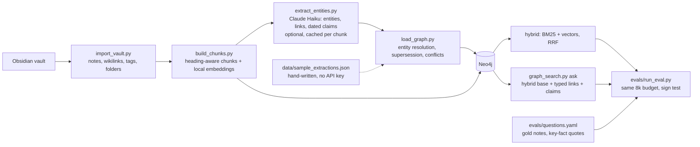

# GraphRAG vs hybrid RAG: a retrieval eval on private notes

[](https://github.com/s0yabean/graphrag-vs-hybrid-rag-eval/actions/workflows/ci.yml)

A local Neo4j knowledge graph built from an Obsidian vault (notes, chunks, LLM-extracted entities, typed links and
dated claims), a hybrid search baseline, and a retrieval eval that compares the two on the same questions.

Write-up with the full results: [GraphRAG vs hybrid RAG: testing Microsoft Research's claim on 13,000 private notes](https://tonytonggg.com/writing/graphrag-vs-hybrid-rag-on-private-notes).

## The problem

Microsoft Research's GraphRAG work argues that turning a corpus into a graph of entities, relationships and claims
before retrieval gives better answers than plain vector search. The question here was whether that holds for a
real, private knowledge base: 13,284 Markdown notes with five years of decisions, pivots and figures that
contradict each other over time, where plans and AI-chat suggestions sit next to records of what actually happened.

Constraints: everything runs on a laptop (local Neo4j, local embeddings); the only text that leaves the machine is
a one-time extraction call per chunk; and the comparison has to be fair, with both methods judged inside the same
8,000-token context budget.

## Approach



- **Three layers in one database.** Structure (`Note`, `Tag`, `Folder`, `LINKS_TO`), evidence (`Chunk` with an
  embedding, `NEXT_CHUNK`) and knowledge (`Entity`, `Claim`, 29 relationship types). Every claim and link points
  back to the chunks that support it.
- **Claims are nodes with two clocks and a modality.** `valid_from` is when a fact became true, `note_date` when it
  was written down. A later note with a different value marks the earlier claim `SUPERSEDED_BY`; same-date
  disagreements get `CONFLICTS_WITH`. `modality` is one of `fact`, `reported`, `plan`, `opinion`, `hypothetical`,
  `ai_suggestion`, so "this was only planned" survives into the answer context.
- **Search rules live in code.** `graph_search.py` enforces hop limits (1 by default, 2 at most), never traverses
  through hub entities, caps fan-out, trims context lines by embedding similarity to the question, and cuts the
  output to a token budget, so an agent calling it cannot talk itself past the limits.
- **A fair eval.** Both methods start from the identical hybrid ranking; the graph adds context lines and extra
  chunks inside the same budget. Gold notes are graded (essential, supporting, distractor), key facts carry exact
  quotes, and per-question wins and losses go through a sign test.

## Results

Published numbers from the private vault (47 hand-labelled questions, 44 scored). The questions and notes are not
in this repo; see [results/summary.md](results/summary.md) for all published aggregates.

| Comparison (44 scored questions) | Hybrid | Graph variant |
|---|---|---|
| Round 1, graph alone: gold notes in the top 10 | 0.53 | 0.39 (hybrid wins 15, loses 5, p = 0.04) |
| Round 1, graph alone: key facts within 8,000 tokens | 0.47 | 0.37 |
| Round 2, graph on top of hybrid: key facts within 8,000 tokens | 0.47 | 0.48 (3 better, 3 worse, 38 the same) |
| Round 2, temporal questions: gold notes within budget | 0.40 | 0.53 |
| Round 2, modality traps: gold notes within budget | 0.60 | 0.47 |
| Round 3, 7x larger graph: median latency | 0.8 s | 4.2 s (after the alias lookup fix) |
| Round 3, relevance trim switched off: key facts within 8,000 tokens | 0.51 | 0.40 (1 better, 12 worse, p = 0.003) |

In short: the graph alone retrieved worse than hybrid search. Layered on top of hybrid search it tied overall,
helped questions about how things changed over time, and hurt questions about plans that never happened. The
relevance trim is what keeps the graph from crowding out evidence, and it is most of the graph's latency. The
one-time extraction for 13 folders cost about $28; every query runs locally.

## Quickstart

About five minutes, no API key. Needs Docker and Python 3.10+.

```bash
cp .env.example .env               # set NEO4J_PASSWORD (8+ characters); change the ports if 7474/7687 are taken
docker compose up -d               # Neo4j 5.26 community, data in a named volume
python3 -m venv .venv && . .venv/bin/activate
pip install -r requirements.txt

python import_vault.py             # 54 notes, links, tags, folders from sample_vault/
python build_chunks.py             # chunks + embeddings (downloads a ~70 MB model on first run)
python load_graph.py --source sample   # hand-written extraction: entities, links, claims
python evals/validate.py           # checks gold paths and quotes
python evals/run_eval.py --methods hybrid graph graph_notrim
```

The last command prints per-question timings and writes `evals/results/<timestamp>/summary.md`: a verdict per
question type, per-question wins and losses with a sign test, and every metric per split.

Then try the graph directly:

```bash
python graph_search.py timeline "Harbour Blend" --attribute "wholesale price"
python graph_search.py path "Late Alta Verde shipments 2025" "The Copper Kettle"
python graph_search.py ask "Did Fernwick open its second roastery in Millbrook?"
```

The `timeline` shows every recorded price with its modality (the AI chat's $32 is marked `ai_suggestion`, the
decisions as `plan`) and which values are superseded. The `path` follows `LED_TO` links from late shipments to a
supplier switch, a price rise and a lost client.

Tests need no Docker, model download or API key (Neo4j and the embedder are replaced by in-memory fakes):

```bash
pip install -r requirements-dev.txt && pytest -q
```

**About the sample.** `sample_vault/` is synthetic: a fictional coffee roaster, with invented people, companies and
numbers. Its extraction in `data/sample_extractions.json` was written by hand, so it is cleaner than an LLM's and
favours the graph; the sample run shows the pipeline working, not the published result.

**Embeddings.** The published results used `bge-m3` (1,024 dimensions, multilingual) through Ollama. To match
them, `ollama pull bge-m3`, set `EMBED_BACKEND=ollama` in `.env`, and rerun `build_chunks.py`. The quickstart
default is `BAAI/bge-small-en-v1.5` via fastembed (384 dimensions, CPU).

**Extraction with Claude Haiku (optional).** Set `ANTHROPIC_API_KEY`, then:

```bash
python extract_entities.py --sample 5     # under a cent; all 54 sample chunks cost about $0.05
python load_graph.py --source api
```

Results are cached per chunk by a hash of model, prompt and text, so reruns never bill twice, and the script
stops before sending if its estimate exceeds `--max-usd` (default $0.50).

**Your own vault.** Point `VAULT_PATH` at it, set `AUTHOR_NAME`, raise `HUB_MENTIONS` (300 was used for 31,047
chunks), and write questions from your own notes. Index one folder at a time with `--folder`.

## Repo layout

```
config.py               settings from .env; embedding backends (ollama, fastembed)
import_vault.py         structure layer: Note, Tag, Folder, LINKS_TO (read-only on the vault)
build_chunks.py         evidence layer: heading-aware chunks, embeddings, vector + full-text indexes
extract_entities.py     knowledge extraction with Claude Haiku, structured outputs, per-chunk cache (optional)
load_graph.py           entity resolution, typed links, claims, supersession and conflicts
graph_search.py         ask / entity / timeline / path, with hop, hub, fan-out and budget limits
docker-compose.yml      local Neo4j
data/                   sample_extractions.json: hand-written extraction of the sample vault
sample_vault/           synthetic Obsidian vault (54 notes)
evals/
  questions.yaml        16 questions for the sample vault across 9 types
  run_eval.py           runs methods, scores, writes summary.md
  validate.py           checks questions against the graph
  methods/              hybrid.py, graph.py, graph_notrim.py
results/summary.md      the published aggregate numbers
tests/                  pytest suite: metrics, chunking, graph layer, hybrid search, eval runner
```

## Design decisions

| Decision | Chosen | Rejected | Why |
|---|---|---|---|
| Where the graph lives | Local Neo4j | Hosted graph database | Private notes stay on the machine |
| Embeddings | `bge-m3` locally | Hosted embedding API | Privacy, zero per-query cost, multilingual notes |
| Extractor | Claude Haiku 5.5, JSON schema enforced | Larger models | A few dollars per folder; quality checked on samples first |
| Facts | Claims as nodes with modality and two dates | Properties on entities | Contradictions and plans become queryable instead of overwritten |
| Entity merging | Rules first (normalisation, specific aliases only) | Merge on any alias | Alias chains merged unrelated entities; identity needs precision |
| Search limits | Enforced in `graph_search.py` | Prompt instructions | An agent can ignore a prompt, not code |
| Graph's role | A layer on top of hybrid search | A replacement | Alone it lost; on top it tied and helped time-based questions |

## What I'd do next

- **An answer-level eval.** The graph's main extras (superseded, planned, AI-suggested) are labels a retrieval
  metric cannot see. The open question is whether they stop the answering model from reporting a stale or
  planned-only figure as current.
- **Route by question shape.** Use hybrid by default (under a second) and the graph only for timelines, multi-step
  links and fact-versus-plan questions, where it earned its extra seconds.
- **Filter inside the index.** Folder filters applied after a vector over-fetch changed rankings when other folders
  were added; a multi-team deployment needs per-permission-scope indexes, and a permissions check right before
  the answer is generated.
- **Stricter merge rules for generic names.** The original build added two LLM merge passes on top of the rules
  here; at scale they still folded generic names into specific ones. Those passes are not in this repo.

## Licence

MIT, copyright Tony Tong. See [LICENSE](LICENSE).
